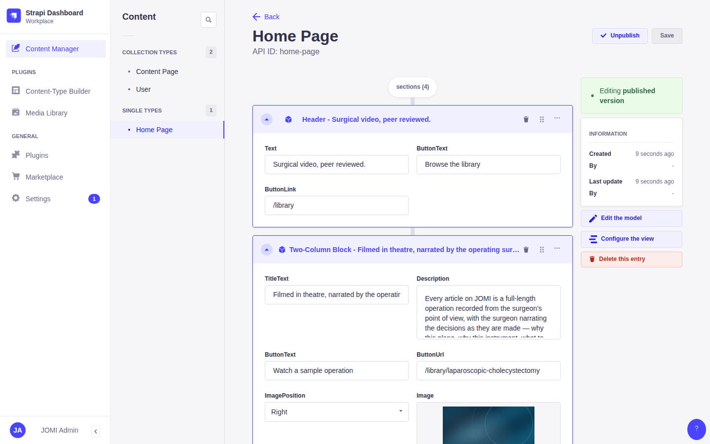
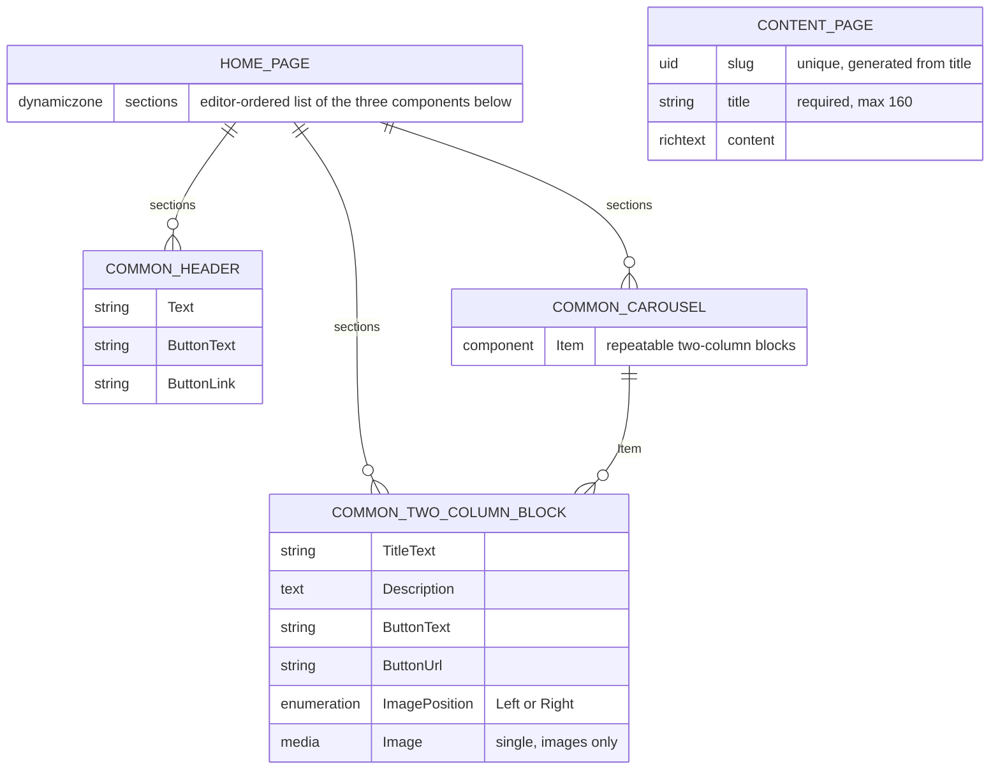
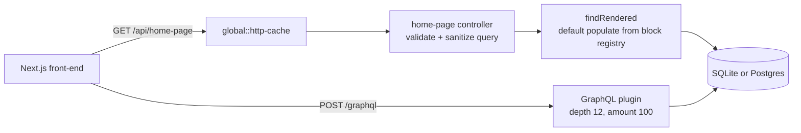

# JOMI CMS challenge — backend

A Strapi 4 (4.26) headless CMS that serves one **Home Page** to the Next.js front-end in
[`jomi-challenge-frontend`](https://github.com/jomijournal/jomi-challenge-frontend). The
challenge repository arrived with the content model already built — the brief's own words
are *"the CMS server has pre-defined types and components"* — so the backend half of the
exercise is a **content** deliverable, not a code one. That brief is reproduced verbatim,
with its mockups, in [`docs/CHALLENGE.md`](docs/CHALLENGE.md).

> **What is this repository's own.** The content model and most of `config/` are
> `create-strapi-app` output plus the JOMI starter. The work layered on top — the homepage
> content, a block registry, populate handling, a cache-header middleware, GraphQL limits,
> a Docker stack and a Jest suite — is listed under
> [Layered on top of the starter](#layered-on-top-of-the-starter). Nothing outside the brief
> was invented: widening an interview exercise's scope only makes it harder to review.

## The deliverable

> "build the content for the homepage so that the frontend can consume it … 2 Two-Column
> Blocks, 1 HeaderBlock, CarouselBlock"

| Asked for | Status | Where to see it |
| --- | --- | --- |
| 2 × Two-Column Block on the Home Page | done | [`src/seed/content.js`](src/seed/content.js) · [screenshot](docs/screenshots/01-home-page-content-manager.png) · [captured API response](docs/api-examples.md) |
| 1 × Header Block | done | same |
| 1 × Carousel Block, 3 items | done | same |
| The three front-end tasks (`homepage.graphql`, `yarn gen`, the block components) | elsewhere | they belong to [`jomi-challenge-frontend`](https://github.com/jomijournal/jomi-challenge-frontend) |

That is the whole backend half of the brief — there were no other backend tasks.

**Why the content is a file, not just database rows.** Content typed into the admin panel
lives in a git-ignored database, so on a plain clone the deliverable is invisible and a
reviewer has to take the screenshots on trust. It is therefore declared in
[`src/seed/content.js`](src/seed/content.js) — a pure module an idempotent bootstrap
seeder writes into whatever database is configured. That makes the 2 / 1 / 1 composition
diffable, reproducible on a fresh boot, and assertable:
[`tests/seed-content.test.js`](tests/seed-content.test.js) checks the counts, that every
field is filled, that every link uses a scheme the front-end's `safeHref` accepts, and
that every referenced image is present on disk. The seeder skips a Home Page that already
has sections, so anything an editor changes in the admin panel survives a restart.



Also captured: [the dynamic zone expanded](docs/screenshots/02-home-page-sections.png),
[the Content-Type Builder](docs/screenshots/03-content-type-builder.png) and
[the seeded media library](docs/screenshots/04-media-library.png). Playwright, Chromium,
1440×900, against the Docker Compose stack below (Strapi 4.26.2, Node 22, Postgres).

## Run it

The quickest path is Docker Compose, which builds the image, starts Postgres and seeds
everything:

```bash
cp .env.example .env
# fill in APP_KEYS (four comma-separated values), ADMIN_JWT_SECRET, API_TOKEN_SALT,
# JWT_SECRET and DATABASE_PASSWORD, each from:  openssl rand -base64 32
# optionally SEED_ADMIN_PASSWORD, to skip the admin registration screen
docker compose up --build -d     # admin http://localhost:8270/admin
bash scripts/smoke.sh            # five end-to-end checks against the running stack
docker compose down -v
```

Compose refuses to start until those five values are set; nothing secret is checked in.
With `SEED_ADMIN_PASSWORD` set, the first boot creates an admin as `admin@jomi.local`
(override with `SEED_ADMIN_EMAIL`); without it the admin panel opens on its registration
screen. Postgres is published on `localhost:8271` for inspection.

Without Docker, on Node 22 (`.nvmrc`) and SQLite:

```bash
nvm use
yarn install
cp .env.example .env     # fill in the four secrets as above
yarn develop             # http://localhost:1337/admin
```

Set `SEED_ON_BOOTSTRAP=true` in that `.env` and the first boot creates the Home Page, its
media, the public read permissions the front-end needs and, with `SEED_ADMIN_PASSWORD`,
an admin user.

`.yarnrc` turns off yarn's engine check. Strapi 4.26 supports Node 22, but one of its
build-tool dependencies, `@strapi/pack-up` (used only to build Strapi plugins), still
declares `node <=20` and would otherwise stop `yarn install`.

Point the front-end at it with three variables in *its* `.env`:

```bash
CMS_SOURCE=strapi
STRAPI_URL=http://localhost:8270/graphql
STRAPI_CMS_URL=http://localhost:8270     # so next/image may load the seeded media
```

`.env.example` is the annotated list of every variable this CMS reads, with defaults. The
four secrets are the only required ones for `yarn develop` — Strapi will not start without `APP_KEYS`, and the
admin panel will not issue a session without `ADMIN_JWT_SECRET`. Generate each with
`openssl rand -base64 32`; none has a fallback in `config/`.

## The content model



Both content types and all three components came with the challenge repository. The only
changes here are on `Two-Column Block` — `ImagePosition` gained a `Left` default and
`Image` was narrowed from every media kind to `allowedTypes: ['images']`, which is what
the front-end renders it as — and on `Content Page`, whose `slug` became a `uid` generated
from `title` rather than a free-text string.

The cross-repository contract is the three GraphQL `__typename`s and their field names.
`jomi-challenge-frontend` switches on `ComponentCommonHeader`,
`ComponentCommonTwoColumnBlock` and `ComponentCommonCarousel`; renaming an attribute here
breaks a separate deployable, so
[`tests/content-model.test.js`](tests/content-model.test.js) asserts the names, the two
`ImagePosition` values and `Image` being single-media directly against the schema JSON.
The two repositories agree today.

## Layered on top of the starter

- **A block registry.** [`src/lib/blocks.js`](src/lib/blocks.js) declares each member of
  the dynamic zone once — `__typename`, scalar fields, media fields, nested components —
  and three consumers derive from it instead of restating it: the populate tree, the
  seeder, and the contract test. Adding a block to the homepage is a component JSON, a
  line in the Home Page schema and one registry entry. Miss the registry entry and
  `tests/content-model.test.js` fails with the component name in the message.
- **A populated `GET /api/home-page`.** Strapi does not populate dynamic zones unless
  asked, so the stock endpoint answers 200 with no `sections` — technically fine, useless
  to every caller. The controller defaults the registry-derived populate tree, and leaves
  an explicit `?populate=` alone so a caller narrowing the response still gets the cheap
  query it asked for. It also coerces the string booleans a query string produces:
  `?populate[sections]=true` arrives as `{ sections: 'true' }`, which Strapi 4.1's
  `convertNestedPopulate` rejected with a 500. `normalizePopulate` in
  [`src/lib/populate.js`](src/lib/populate.js) turns those strings into booleans. Before
  any of that, the query goes through Strapi's own `validateQuery` and `sanitizeQuery`,
  exactly as in the core controller, so filtering or populating on private attributes
  (`?filters[createdBy][password]...`) is a 400, not a data leak. GraphQL is unaffected:
  it derives populate from the selection set.
- **GraphQL depth and amount limits** ([`config/plugins.js`](config/plugins.js)). The
  endpoint is public and the schema is cyclic through media relations, so without a depth
  limit one hand-written query can nest until the process dies. Depth is capped at 12
  against the front-end's deepest real query of 9; `amountLimit: 100` stops one query
  asking for every row. The playground and introspection are off in production —
  introspection stays on elsewhere because the front-end's `yarn gen` needs it.
- **`Cache-Control` on anonymous content reads** ([`src/lib/http-cache.js`](src/lib/http-cache.js),
  registered as `global::http-cache`). Strapi CE ships no response cache and an in-process
  one would be the wrong layer; `public, max-age=60, stale-while-revalidate=600` lets a CDN
  absorb a spike while one request refreshes. Deliberately conservative — an
  `Authorization` header, a request cookie, a `Set-Cookie`, a non-200, a non-`/api` path or
  a `Cache-Control` a controller already set each disable it, because a wrongly shared
  response is a data leak rather than a slow page.
- **`DATABASE_CLIENT` as a table of connection builders**
  ([`config/database.js`](config/database.js)). SQLite by default so `yarn develop` needs
  no services, Postgres for Docker, an unsupported value failing at startup with a named
  error rather than a stack trace, and a bounded pool — `DATABASE_POOL_MAX` is what stops
  a spike opening more connections than Postgres will accept. A relative
  `DATABASE_FILENAME` resolves against the project root; an absolute one is now honoured
  verbatim instead of being joined onto it.
- **The seeder, split by lifecycle.** `Strapi.runLifecyclesFunctions` runs the
  *application's* `bootstrap()` before the *admin plugin's*, so at `src/index.js` time the
  `strapi-super-admin` role does not exist yet and seeding an admin there silently does
  nothing — the only symptom being an unexpected registration screen. Content, media and
  permissions run in `bootstrap()`; the admin step is deferred to the HTTP server's
  `listening` event by `afterServerReady` in [`src/seed/index.js`](src/seed/index.js), and
  [`tests/seed-admin.test.js`](tests/seed-admin.test.js) pins it there.
- **Read endpoints for `Content Page`**, which had a schema but no controller, routes or
  service, so it was never reachable over REST. It has no relations and no dynamic zone,
  so the generated CRUD is right and those three files are plain factory calls.
- **`Dockerfile`, `docker-compose.yml`, `jest.config.js`, `scripts/smoke.sh`** and the
  Jest suite below.

Three files that came with the starter were removed. Two were JOMI's own deploy setup
(`ecosystem.config.js` and a job for their self-hosted server that copied
`/srv/apps/app.env` over `.env` and ran `pm2 restart`). PM2 was never a dependency, the
server does not exist for a fork, and the files published the shape of someone else's
infrastructure.
`src/components/hero/hero-section.json` was a component with zero attributes that nothing
referenced.

## Checks

```
$ yarn test
Test Suites: 9 passed, 9 total
Tests:       126 passed, 126 total
```

`yarn lint` is clean. No suite boots Strapi; that would mean a database, a full plugin
load and several seconds per suite, mostly testing Strapi rather than this code. The unit
suite covers `src/lib`, `src/seed`, the cache middleware, the Home Page controller (with
`@strapi/strapi` mocked) and `config/`: the populate tree, the cache policy's refusals,
query sanitization order, the seed composition, the config values and environment
parsing.

The boot path is covered by [`scripts/smoke.sh`](scripts/smoke.sh), which drives a
*running* instance through five checks: `/_health`, the 2 / 1 / 1 dynamic zone with media
populated, the `Cache-Control` header, the front-end's own GraphQL document, and an
over-deep query being rejected. It defaults to the Compose stack; point `BASE_URL` at a
`yarn develop` instead:

```bash
BASE_URL=http://localhost:1337 bash scripts/smoke.sh
```

Its full output, and the complete REST and GraphQL request/response pairs behind the table
above, are in [`docs/api-examples.md`](docs/api-examples.md), captured from the Compose
stack.



## Known gaps

- **Strapi 4 is the end of the line for this code.** 4.26.2 is the last v4 release.
  `yarn audit` still reports one critical advisory against `@strapi/strapi` itself
  ([GHSA-rjg2-95x7-8qmx](https://github.com/advisories/GHSA-rjg2-95x7-8qmx), sensitive
  data leaking through relational filtering), fixed only in 5.37.0, plus high-severity
  findings in transitive packages Strapi pins (sharp 0.32, graphql-upload's `dicer`,
  `@koa/cors` 3, markdown-it, webpack-dev-middleware). The custom Home Page endpoint
  sanitizes its query and the Content Page endpoints use the core controllers, but the
  real fix is a Strapi 5 migration. That changes the REST and GraphQL response shape
  (no more `data.attributes`) and therefore needs a matching change in
  `jomi-challenge-frontend`.
- **Patched transitive versions are forced with `resolutions`** in `package.json`
  (`@casl/ability`, `axios`, `tar`, and `minimatch`, `ws` and `vite` under the Strapi
  packages that pin them). Remove them when moving off Strapi 4.
- **Nothing in `yarn test` boots Strapi**; the booted behaviour is covered by
  `scripts/smoke.sh` against a running instance.
- **`CORS_ORIGIN` defaults to `*`** so a fresh clone works. That is a development default.
- **The seeder can create a super admin from environment variables.** It refuses once any
  admin exists, but do not carry `SEED_ON_BOOTSTRAP=true` into a real deployment.
- **The carousel component carries no presentation settings**: no interval, no slide
  count, no autoplay. It is a repeatable list of Two-Column Blocks and nothing more, so
  presentation is entirely the front-end's decision.
- **No i18n content.** The plugin is installed but no locale beyond the default is
  configured, and the seed content is English only.
- **Draft/publish is on** for both content types, so anything created through the API
  without `publishedAt` is invisible to the public endpoints. The seeder sets it.

## Licence

MIT, see [`LICENSE`](LICENSE). `docs/CHALLENGE.md` reproduces JOMI's brief and mockups
verbatim and those remain theirs.
